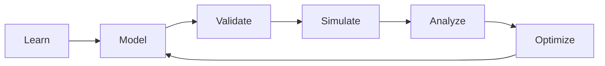
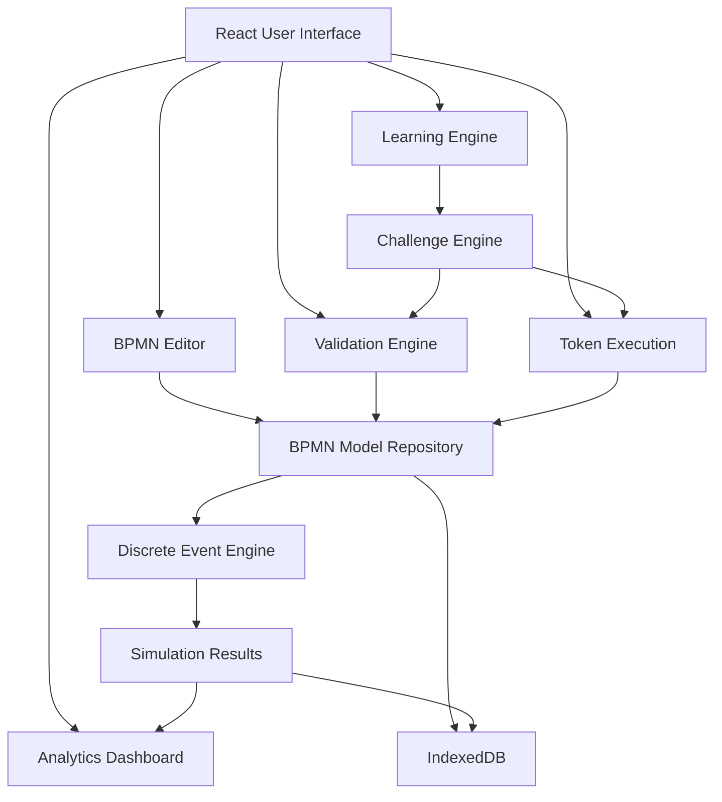

# 2. BPMN Studio

## 2.1 Application Overview

**Working name:** BPMN Studio

**Full name:** Interactive BPMN Modeling, Simulation and Optimization Environment

**Priority:** P1

**Application type:** Interactive educational web application

**Target audience:** Undergraduate and graduate students studying Business Process Management.

### Vision

BPMN Studio must be substantially more than a conventional BPMN editor.

It should provide an environment where students can:

- Learn BPMN notation
- Build BPMN models
- Validate modeling correctness
- Execute animated process simulations
- Analyze execution behavior
- Conduct performance experiments
- Identify modeling and execution problems
- Compare AS-IS and TO-BE processes
- Complete guided educational challenges

### Core Learning Cycle



---

# 3. BPMN Studio — Functional Modules

## 3.1 Module A: Interactive BPMN Modeler

### Objective

Provide a visual BPMN 2.0 modeling environment with educational assistance.

### Core Features

- Drag-and-drop BPMN elements
- Standards-based BPMN diagrams
- BPMN 2.0 XML import/export
- Undo and redo
- Zoom, pan, and fit-to-screen
- Element properties panel
- Context-sensitive modeling tools
- Keyboard shortcuts
- Autosave
- Multiple saved diagrams
- Example diagram library
- Light and dark modes
- Responsive interface

### BPMN Elements

#### Events

- Start Event
- End Event
- Intermediate Catch Event
- Intermediate Throw Event
- Timer Event
- Message Event
- Error Event
- Escalation Event
- Signal Event
- Conditional Event
- Boundary Event
- Terminate End Event

#### Activities

- Task
- User Task
- Service Task
- Manual Task
- Script Task
- Business Rule Task
- Send Task
- Receive Task
- Subprocess
- Call Activity
- Loop Activity
- Multi-instance Activity

#### Gateways

- Exclusive Gateway (XOR)
- Parallel Gateway (AND)
- Inclusive Gateway (OR)
- Event-based Gateway
- Complex Gateway

#### Collaboration

- Pools
- Lanes
- Sequence Flows
- Message Flows
- Associations
- Data Objects
- Data Stores
- Groups
- Text Annotations

### Educational Interactions

Selecting an element should reveal:

1. BPMN element name
2. Graphical meaning
3. Execution semantics
4. Typical use cases
5. Common modeling mistakes
6. Related concepts
7. A miniature interactive example

### Example

Selecting a Parallel Gateway should explain:

- Parallel branching
- Concurrent token execution
- Synchronization behavior
- Difference between XOR and AND
- Risks of improper gateway pairing

Students should be able to execute a miniature demonstration directly from the explanation.

---

## 3.2 Module B: BPMN Learning Mode

### Objective

Enable students to progressively learn BPMN concepts through guided interactions.

### Learning Levels

#### Level 1: Fundamentals

- Processes and activities
- Events
- Sequence flows
- Basic process structure

#### Level 2: Decisions

- Exclusive gateways
- Conditional routing
- Default flows
- Parallel gateways

#### Level 3: Advanced Control Flow

- Inclusive gateways
- Event-based gateways
- Synchronization
- Loops
- Deadlocks

#### Level 4: Collaboration

- Pools and lanes
- Message flows
- Interorganizational processes

#### Level 5: Advanced BPMN

- Subprocesses
- Boundary events
- Error handling
- Timer events
- Escalations
- Compensation concepts

### Learning Interactions

Each concept should have:

- Short explanation
- Visual example
- Interactive demonstration
- Typical mistake
- Short exercise
- Knowledge check

### Gamification

Optional features:

- Progressive learning levels
- Achievement badges
- Challenge completion tracking
- Skill progression
- Hints
- Formative feedback

The system should prioritize understanding rather than superficial point collection.

---

## 3.3 Module C: BPMN Validator

### Objective

Identify BPMN modeling errors and explain their consequences.

### Validation Categories

#### Structural Validation

Detect:

- Disconnected elements
- Unreachable activities
- Missing incoming or outgoing flows where inappropriate
- Incorrect sequence flows
- Invalid message flows
- Missing gateway conditions
- Incorrect element configurations

#### Control-Flow Validation

Detect or flag:

- Potential deadlocks
- Parallel synchronization problems
- Unintended token duplication
- Potential infinite loops
- Dead paths
- Incorrect gateway usage

Advanced behavioral findings should only be reported when supported by formal analysis or clearly labeled as warnings.

#### Semantic and Educational Validation

Examples:

- Using a parallel gateway where an exclusive decision is intended
- Modeling interactions between participants incorrectly
- Omitting exception handling in a specified scenario
- Using an ambiguous process structure

### Feedback Format

Each detected issue should provide:

- Severity
- Affected BPMN element
- Explanation
- Possible consequence
- Suggested correction
- Related learning material

### Severity Levels

| Level | Meaning |
|---|---|
| Error | Invalid or unsupported model |
| Warning | Potential behavioral or modeling problem |
| Recommendation | Improvement opportunity |
| Information | Educational explanation |

### Important Requirement

The validator must distinguish:

1. XML and structural validity
2. BPMN semantic correctness
3. Executability by the selected simulation engine
4. Pedagogical recommendations

A model can be valid BPMN but unsupported by the simulator.

---

## 3.4 Module D: Animated Token Simulation

### Objective

Allow students to observe process execution directly on the BPMN diagram.

### Simulation Controls

- Play
- Pause
- Stop
- Reset
- Step forward
- Execution speed
- Token highlighting
- Current activity inspection
- Execution history
- Event trace

### Required Demonstrations

#### Sequential Execution

A token moves from one activity to the next.

#### Exclusive Decisions

Exactly one outgoing path is selected according to routing semantics.

#### Parallel Execution

A parallel gateway creates multiple concurrent execution paths.

#### Synchronization

A joining parallel gateway waits for required tokens.

#### Loops

Tokens can revisit activities.

#### Boundary Events

An interrupting boundary event cancels its attached activity and redirects execution.

#### Deadlocks

Tokens become blocked because execution requirements cannot be satisfied.

#### Event-Based Decisions

Competing events determine the subsequent execution path.

### Simulation Inspection Panel

Display:

- Active tokens
- Completed activities
- Enabled activities
- Gateway decisions
- Waiting tokens
- Execution trace
- Current simulation state

### Educational Feature: Explain Execution

Students should be able to select a token and understand:

- Why the token exists
- Which activity produced it
- Why it followed a specific path
- What conditions are required for continuation

### Important Technical Constraint

Token animation must not be confused with a complete BPMN execution engine.

Unsupported BPMN elements and behaviors must be explicitly identified.

---

## 3.5 Module E: Process Performance Simulation

### Objective

Introduce discrete-event simulation into BPMN-based process analysis.

This should be developed as a separate engine from token animation.

### Simulation Inputs

#### Case Arrival

- Fixed arrival intervals
- Poisson arrivals
- Custom arrival distributions
- Batch arrivals

#### Activity Durations

- Constant
- Uniform
- Triangular
- Normal with nonnegative sampling policy
- Lognormal
- Empirical distribution

#### Routing

- Conditional routing
- Probabilistic routing for simulation scenarios
- Event-based routing
- Parallel branching

#### Resources

- Number of available workers
- Resource pools
- Resource assignments
- Availability schedules
- Resource costs
- Resource utilization

#### Queues

- FIFO
- Priority-based
- Configurable capacity
- Queue discipline

#### Costs

- Processing cost
- Labor cost
- Waiting cost
- Fixed activity cost
- Rework cost

### Simulation Outputs

- Cycle time
- Processing time
- Waiting time
- Throughput
- Work in progress
- Resource utilization
- Queue length
- SLA compliance
- Process cost
- Rework frequency
- Activity execution frequency

### Simulation Dashboard

The dashboard should include:

- KPI cards
- Activity performance charts
- Waiting-time distributions
- Resource utilization charts
- Bottleneck visualization
- Case completion timeline
- Process-path frequencies

### Experiment Configuration

Students should be able to:

1. Define simulation parameters.
2. Choose the number of cases.
3. Set a random seed.
4. Execute the simulation.
5. Review results.
6. Modify assumptions.
7. Repeat under comparable conditions.

### Scientific Correctness

The simulation engine must support:

- Reproducible random seeds
- Explicit resource scheduling
- Correct queue management
- Clock-based event scheduling
- Defined completion criteria
- Separate waiting and processing times
- Event tracing
- Documented statistical assumptions

For simulation experiments, support independent replications and configurable warm-up periods.

---

## 3.6 Module F: AS-IS vs. TO-BE Optimization

### Objective

Allow students to evaluate process redesign alternatives quantitatively.

### Workflow

1. Create AS-IS process model.
2. Configure workload and resources.
3. Execute baseline simulation.
4. Duplicate the model.
5. Modify activities, routes, or resources.
6. Execute TO-BE simulation.
7. Compare performance.
8. Explain the results.

### Comparison Metrics

| Metric | AS-IS | TO-BE | Improvement |
|---|---|---|---|
| Average cycle time | Calculated | Calculated | Calculated |
| Waiting time | Calculated | Calculated | Calculated |
| Throughput | Calculated | Calculated | Calculated |
| Process cost | Calculated | Calculated | Calculated |
| SLA compliance | Calculated | Calculated | Calculated |
| Resource utilization | Calculated | Calculated | Calculated |

### Visualizations

- Side-by-side KPI comparison
- Relative improvement percentages
- Distribution comparisons
- Bottleneck changes
- Resource utilization differences
- Cost-benefit analysis

### Educational Questions

- Did the redesign improve cycle time?
- Did the bottleneck move elsewhere?
- Was the improvement economically justified?
- Did resource utilization become excessive?
- Did increased throughput affect process quality?
- Were unintended consequences introduced?

---

## 3.7 Module G: BPMN Challenges

### Objective

Teach BPMN through practical process-solving exercises.

### Challenge Types

#### Build a Process

Create a BPMN model from a textual business scenario.

#### Fix a Broken Model

Identify and correct intentional mistakes.

#### Predict Execution

Predict which activities will execute for specified conditions.

#### Find a Deadlock

Identify the structural cause of blocked execution.

#### Improve a Process

Redesign the model to meet performance objectives.

#### Compare Alternatives

Choose between different BPMN models based on execution behavior and simulation metrics.

### Assessment Dimensions

- Structural correctness
- Required behavior
- BPMN semantic correctness
- Scenario coverage
- Process performance
- Reasoning quality

### Assessment Principles

Do not compare diagrams solely by their visual structure.

Different BPMN models can describe equivalent behavior.

Assessment should combine structural constraints, expected execution traces, model invariants, and scenario-specific requirements.

### Student Feedback

- What is correct
- What needs improvement
- Why an issue matters
- Suggested next learning concept
- Optional progressive hints

---

# 4. BPMN Studio — Technical Architecture

## 4.1 Recommended Stack

| Layer | Technology |
|---|---|
| Frontend | React |
| Language | TypeScript |
| Build system | Vite |
| BPMN editor | bpmn-js |
| Properties | bpmn-js-properties-panel |
| BPMN validation | bpmnlint |
| Token animation | bpmn-js-token-simulation |
| Performance simulation | Custom TypeScript DES engine |
| Visualization | Recharts |
| Local storage | IndexedDB |
| Unit testing | Vitest |
| End-to-end testing | Playwright |

### Relevant Resources

- https://bpmn.io/
- https://github.com/bpmn-io/bpmn-js
- https://github.com/bpmn-io/bpmn-js-token-simulation
- https://github.com/bpmn-io/bpmnlint
- https://github.com/bpmn-io/bpmn-js-properties-panel

Retain the required bpmn.io attribution and verify dependency licenses.

## 4.2 Architecture Principles

1. Modular architecture
2. Clear domain boundaries
3. Standards-compliant BPMN interchange
4. Local-first operation
5. Reproducible simulations
6. Accessible user interface
7. Separation between modeling and simulation
8. Testability
9. Reusable scenario definitions
10. Incremental development

## 4.3 Logical Architecture



## 4.4 Suggested Project Structure

```text
bpmn-studio/
├── src/
│   ├── app/
│   ├── components/
│   ├── features/
│   │   ├── modeler/
│   │   ├── learning/
│   │   ├── validation/
│   │   ├── token-simulation/
│   │   ├── performance-simulation/
│   │   ├── analytics/
│   │   ├── optimization/
│   │   └── challenges/
│   ├── domain/
│   │   ├── bpmn/
│   │   ├── simulation/
│   │   ├── resources/
│   │   └── assessment/
│   ├── data/
│   │   ├── examples/
│   │   ├── lessons/
│   │   └── challenges/
│   ├── services/
│   ├── storage/
│   ├── hooks/
│   ├── utils/
│   └── styles/
├── tests/
│   ├── unit/
│   ├── integration/
│   └── e2e/
├── docs/
│   ├── architecture/
│   ├── simulation-semantics/
│   └── teaching-content/
├── public/
└── README.md
```

## 4.5 Data Interoperability

Keep BPMN XML separate from simulation-specific settings.

### BPMN Model

Store BPMN 2.0 XML with stable element IDs.

### Simulation Configuration

Store separately:

- Activity duration distributions
- Resource pools
- Routing probabilities
- Arrival processes
- Simulation parameters
- Random seed
- Resource calendars

### Simulation Results

Store:

- Run identifier
- Model version
- Configuration version
- Random seed
- Aggregated metrics
- Event trace
- Generated event log

### Data Contracts

Define versioned TypeScript interfaces and JSON Schemas for:

- Process model metadata
- Simulation configuration
- Simulation run
- Event log
- Assessment result
- Educational scenario

This enables future integration with Process Mining Detective and Process Digital Twin Studio.

---

# 5. BPMN Studio — Development Roadmap

## Phase 1: Modeling Foundation

### Scope

- [x] Initialize React/TypeScript/Vite project
- [x] Integrate bpmn-js
- [x] Configure modeler interface
- [x] Implement properties panel
- [x] Implement BPMN XML import/export
- [x] Add undo/redo
- [x] Add zoom and fit controls
- [x] Implement IndexedDB persistence
- [x] Create example diagrams
- [x] Add light/dark theme
- [x] Configure testing infrastructure

### Acceptance Criteria

- Students can build valid basic BPMN diagrams.
- Models can be saved and reopened.
- Imported and exported BPMN XML preserves supported elements.
- The editor remains usable without a backend.

## Phase 2: Educational Features

### Scope

- [x] BPMN element encyclopedia
- [x] Contextual explanations
- [x] Interactive examples
- [x] Guided tutorials
- [x] Structural validation
- [x] Educational lint rules
- [x] Error explanations
- [x] First BPMN challenges

### Acceptance Criteria

- Students can learn core BPMN notation within the app.
- Validation provides actionable feedback.
- Guided tutorials can be completed without instructor intervention.

## Phase 3: Token Simulation

### Scope

- [x] Integrate token simulation extension
- [x] Implement execution controls
- [x] Highlight active elements
- [x] Provide event history
- [x] Implement step execution where supported
- [x] Explain routing decisions
- [x] Demonstrate synchronization
- [x] Detect blocked execution states where supported

### Acceptance Criteria

- Supported models execute correctly.
- Students can observe routing and concurrency.
- Unsupported execution constructs are reported explicitly.

## Phase 4: Performance Simulation

### Scope

- [x] Define DES architecture
- [x] Implement simulation event queue
- [x] Implement arrival distributions
- [x] Implement activity durations
- [x] Implement resource allocation
- [x] Implement waiting queues
- [x] Implement routing behavior
- [x] Implement KPI calculations
- [x] Add reproducible random seeds
- [x] Export event logs
- [x] Create analytics dashboard

### Acceptance Criteria

- Simulations are reproducible.
- Resource constraints affect cycle time.
- Queue metrics are calculated correctly.
- Event logs can be exported.
- Unsupported BPMN semantics do not produce misleading results.

## Phase 5: Optimization

### Scope

- [x] Duplicate model as TO-BE
- [x] Compare process versions
- [x] Compare simulation metrics
- [x] Visualize differences
- [x] Implement scenario experimentation
- [x] Add bottleneck reports
- [x] Add interpretation guidance

### Acceptance Criteria

- Students can conduct controlled redesign experiments.
- Comparisons use equivalent assumptions or clearly disclose differences.
- Improvement metrics are calculated consistently.

## Phase 6: Advanced Learning

### Scope

- [x] Challenge evaluation
- [x] Automatic formative feedback
- [x] Progressive hints
- [ ] Optional AI tutor
- [ ] Optional BPMN generation from text
- [x] Learning progress tracking
- [x] Additional advanced BPMN examples

### Acceptance Criteria

- Challenges provide explainable results.
- Students can understand why an answer is correct or incorrect.
- AI-generated models are validated and never assumed to be correct.

---

# 6. Development Agents

## 6.1 Agent Structure

Use specialized development agents with clearly separated responsibilities.

### Agent 1: Architecture and Integration

Responsibilities:

- Define project architecture
- Establish data contracts
- Manage cross-module dependencies
- Define coding conventions
- Review interfaces
- Maintain documentation
- Manage integration

### Agent 2: BPMN Editor

Responsibilities:

- bpmn-js integration
- BPMN properties
- Diagram manipulation
- Import/export
- Persistence
- Modeling user experience

### Agent 3: Simulation

Responsibilities:

- Token execution integration
- Discrete-event simulation
- Gateway execution semantics
- Resource allocation
- Queue management
- Statistical sampling
- Event log generation

### Agent 4: Educational Experience

Responsibilities:

- Guided tutorials
- BPMN explanations
- Interactive examples
- Challenge design
- Assessment logic
- Learning progression

### Agent 5: Analytics and Visualization

Responsibilities:

- KPI dashboards
- Process performance visualization
- AS-IS vs. TO-BE comparison
- Statistical summaries
- Event log visualization

### Agent 6: Testing and Quality

Responsibilities:

- Unit tests
- Integration tests
- BPMN semantic test cases
- Simulation correctness tests
- Accessibility checks
- End-to-end tests
- Regression testing

## 6.2 Agent Collaboration Rules

- Define shared interfaces before parallel implementation.
- Assign ownership of files and modules.
- Avoid concurrent modifications to shared infrastructure.
- Implement tests for new functionality.
- Document assumptions.
- Preserve BPMN standard compatibility.
- Report unsupported behavior explicitly.
- Do not silently replace simulation with animations.
- Maintain consistent UI design.
- Integrate changes incrementally.
- Require review before merging shared architectural changes.

## 6.3 Master Agent Prompt

> [!example] Prompt for Codex / Development Agents
>
> Build BPMN Studio, a polished interactive university-level Business Process Management learning environment.
>
> The application must enable students to learn BPMN, construct models, validate correctness, execute token animations, simulate performance, analyze metrics, compare process improvements, and complete guided exercises.
>
> Use React, TypeScript, Vite, bpmn-js, bpmn-js-properties-panel, bpmnlint, bpmn-js-token-simulation, Recharts, IndexedDB, Vitest, and Playwright.
>
> Follow a modular architecture separating the BPMN editor, semantic validation, token execution, discrete-event simulation, analytics, challenges, and persistence.
>
> Support standards-compliant BPMN 2.0 XML import/export. Store simulation-specific metadata separately from BPMN XML.
>
> Implement all features incrementally according to the project roadmap.
>
> Prioritize educational clarity, standards correctness, simulation reproducibility, accessibility, and polished interaction design.
>
> Build and test one complete vertical slice before expanding.
>
> Never claim full BPMN execution support when only a subset is implemented.
>
> Document supported BPMN constructs, limitations, architecture decisions, and acceptance evidence after each phase.

---
