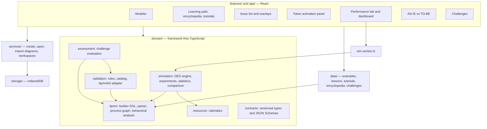

# Architecture

BPMN Studio is a single-page React application without a backend. All logic runs in the browser; data is stored in IndexedDB; simulation experiments run in a Web Worker.

## Layers

- **`domain/`** has no dependency on React, bpmn-js or the DOM (except `bpmn-moddle` for parsing). Everything that decides correctness — validation, behavioral analysis, simulation, assessment — lives here and is unit-tested in Node.
- **`features/`** are UI modules. They may depend on `domain/`, `data/`, `services/` and `components/`, not on each other, except for deliberate reuse (e.g. the challenge panel inside the modeler).
- **`data/`** holds teaching content as typed TypeScript modules written with the diagram builder DSL, so every bundled diagram is generated from one reviewable source with stable element ids.

## The process graph

`domain/bpmn/graph.ts` converts a bpmn-moddle definitions tree into a `ProcessGraph`: nodes (with kind, gateway type, event definition, boundary attachments, loop characteristics), sequence flows (conditions, defaults), message flows and scopes (processes and expanded sub-processes). The validator, the behavioral analysis, the DES engine and the assessment all work on this one representation; the token animation works on the bpmn-js model directly.

## Three different "executions"

| | Behavioral analysis | Token animation | Performance simulation |
|---|---|---|---|
| Purpose | Prove control-flow properties | Show execution semantics | Measure time, cost, utilization |
| Code | `domain/bpmn/behavior.ts` | bpmn-js-token-simulation + `features/token-simulation/controller.ts` | `domain/simulation/engine.ts` |
| Time and resources | No | No | Yes |
| Result | Deadlocks, lack of synchronization, livelocks, dead elements, traces | Animated tokens, history, decisions | KPIs with confidence intervals, event logs |
| Semantics | [behavioral-analysis.md](../simulation-semantics/behavioral-analysis.md) | [token-animation.md](../simulation-semantics/token-animation.md) | [performance-simulation.md](../simulation-semantics/performance-simulation.md) |

The three are deliberately separate (plan principle "do not silently replace simulation with animations"). Each reports what it does not support.

## Persistence and data contracts

IndexedDB database `bpmn-studio`, version 1:

| Store | Key | Content |
|---|---|---|
| `diagrams` | `id` | Process model metadata (`ProcessModelMetadata`) plus the unmodified BPMN 2.0 XML and an SVG preview |
| `simConfigs` | `diagramId` | `SimulationConfig`, keyed by BPMN element ids — never written into the XML |
| `runs` | `runId` | `StoredRunSummary` (event logs are exported, not stored) |
| `progress` | `'me'` | `LearnerProgress` |
| `settings` | `'settings'` | Theme, last diagram, UI state |

The model version increments whenever the XML changes; runs record the model and configuration versions they were produced with. When a model changes, `syncConfigWithGraph` adds defaults for new elements and removes settings of deleted ones.

Contracts (`domain/contracts/index.ts`) carry a `schemaVersion`; JSON Schemas in `domain/contracts/schemas/` describe the exchange formats. `tests/unit/contracts.test.ts` validates real application data against them.

## Simulation in a worker

`features/performance-simulation/simClient.ts` posts the BPMN XML and the configuration to `sim.worker.ts`, which parses the model, runs the replications and reports progress. Cancelling terminates the worker. Without worker support (tests, old browsers) the experiment runs on the main thread.

## Assessment

`domain/assessment/evaluate.ts` combines independent evidence into criteria, each with a dimension (structure, behavior, semantics, scenario, performance, reasoning), status, feedback, rationale and the elements concerned:

- **Roles** identify business activities by keywords in element names, so differently drawn but equivalent models pass.
- **Behavioral queries** (`assessment/queries.ts`) run on the explicit state graph: *always*, *optional*, *exclusive*, *precedes*, *concurrent*.
- **Soundness and validation** reuse the analysis and the validator.
- **Performance** targets of "improve" challenges are checked with a simulation whose workload, seed and durations are fixed by the challenge (`assessment/improve.ts`), so targets cannot be met by editing input data.

## Decisions

| # | Decision | Reason |
|---|---|---|
| 1 | Hash routing, static build | Works from any static host and from a file share in a lab |
| 2 | Simulation settings outside the BPMN XML | Exported XML remains standard; settings are versioned separately |
| 3 | Custom DES engine instead of a library | Full control over BPMN semantics, reproducibility and documentation |
| 4 | Content as typed TypeScript with a builder DSL | Type-checked, reviewable, testable; diagrams have stable ids and layout |
| 5 | Formal analysis for behavioral findings | The plan requires formal support or explicit "warning" labels; heuristics are marked `heuristic` |
| 6 | Common random numbers per element id | Variance reduction and paired confidence intervals for AS-IS vs TO-BE |
| 7 | Assessment by behavior, never by picture | Equivalent models must pass |
| 8 | No AI tutor, no text-to-BPMN | Optional in the plan; omitted rather than shipped without validation |

## Conventions

- TypeScript strict mode, no unused locals/parameters.
- Times in minutes, costs in currency units per hour or per case, probabilities and utilization as fractions.
- User-facing text explains *what*, *why it matters* and *how to fix*.
- New functionality comes with tests; teaching content is validated by tests (parsing, soundness, reference solutions).
